# The Primer — Tutorial

**Design v2 — 29 Oct 2026. Status: approved (Renda, 29 Oct, all five decisions at their recommended default). The blockout is built from this data. Next: the sergeant (#111/#112) and the trap (#101), then a playtest.**

**Identity:** a rebel training course that is honestly a training course. Success is not "the player finished it", it's "the player wants more." The sergeant briefs the player, the course proves them ready, and the fiction excuses the artificial geometry: the rebels built every obstacle.

---

## How this document works

The same way the Ascent's and Last Colour's do: the level is **data**, and the drawings come from it.

| What | Where |
|---|---|
| **The layout, as data** | [`src/levels/layouts/primer.js`](../../src/levels/layouts/primer.js) |
| **Physics check** | [`tests/primer-layout.test.js`](../../tests/primer-layout.test.js): 11 tests on the data, including a **real jump simulation** of the blue gap with the player's own code; [`tests/level-00-primer.test.js`](../../tests/level-00-primer.test.js): 6 on the built level |
| **3D massing model** | [`docs/levels/massing/massing.html?layout=primer`](massing/massing.html) (run `npm run dev`) |
| **Plan, sections, pacing** | [`docs/levels/primer/`](primer/), generated by `node docs/levels/massing/render-diagrams.mjs primer` |
| **The playable level** | `src/levels/level-00-the-primer.js`, a `LayoutLevel` **built from the same data**; [`tests/level-00-primer.test.js`](../../tests/level-00-primer.test.js) checks the build against it |

---

## What v2 keeps, and what it corrects

Everything v1 designed stays: the ten beats, the sergeant's lines, one verb per room, the refusals (no control list, no unskippable anything, no death), and "the tutorial never says which colour is correct". v2 gives it **space**, and corrects **one number that couldn't work**.

### The correction: the blue gap is 6.5 m, not 8 m

v1 said: *"a gap of 8 m, too wide for a jump (4.6 m) and too wide for a blue jump (7.3 m), but momentum carries the rest."* Those jump figures were rough estimates. Measured with the player's actual physics code, 10 m run-up, jumping at the lip:

| Run-up | Furthest gap cleared |
|---|---|
| Grey | **4.66 m** |
| Your own paint (green) | 4.46 m |
| **Blue** | **8.14 m** |

So **8 m clears on blue by 14 cm**, and only with a perfect jump at the very edge. A first-timer who jumps a little early falls in, every time, in the room meant to teach that blue works. **6.5 m** is 1.8 m beyond anything grey can do and 1.6 m inside what blue reaches. A test runs the real simulation: grey must fail, blue must succeed, and **blue must still succeed with a jump a full metre early**. At 8 m that last test fails (checked).

---

## The shape: one course, one verb per room

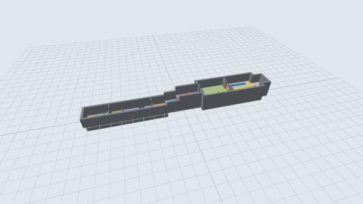

One straight course along one axis, **climbing as it goes**, with **doorways between the lessons** (decision 2): floor 0 for moving, painting and blue; up 3 m on the red bounce; up 5 m more on the green climb; then the hall at 8 m for the Charger, free play and extraction. Each lesson's exit is the next lesson's floor.

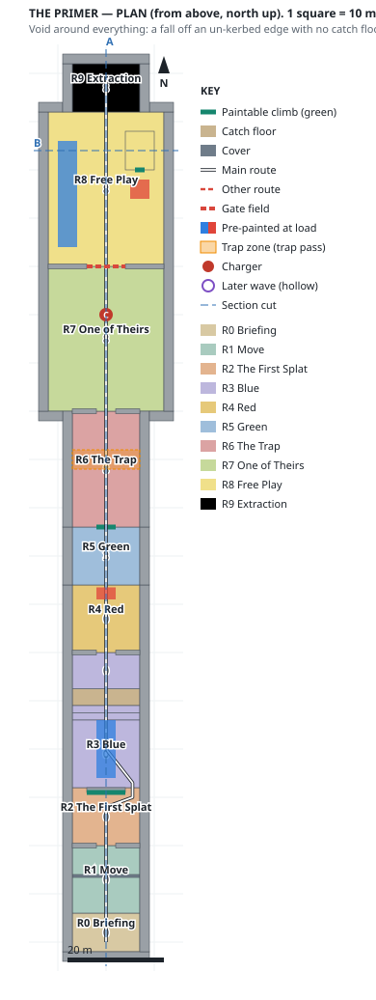

Floors are tinted by room. Solid blue and red rectangles are **paint already on the floor when the level loads**: the teaching examples. Thick teal lines are the paintable walls.

---

## The numbers everything is measured against

| Fact | Value | Source |
|---|---|---|
| Plain jump | **1.39 m** up | `PLAYER` |
| Red bounce | **4.33 m** up | `PLAYER.minBounce` |
| Jump across, grey / blue run-up | **4.66 m / 8.14 m** | Measured, player simulation (above) |
| Climb lip | **0.3 m** | No mantle (#157 is a COULD) |
| Wall contact | chest height, 0.85 m above the feet | `player.js`, so a 1 m wall stops a walk |

---

## Pacing

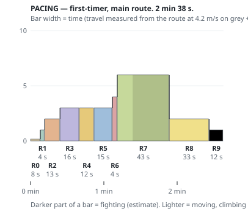

| | Moving (**measured**) | The lesson itself (**estimate**) | Fighting (**estimate**) | Total |
|---|---|---|---|---|
| **Whole course** | **≈ 47 s** | **≈ 81 s** | **30 s** | **≈ 2 min 40 s** |

v1 said "~4 minutes for a first-timer, ~90 seconds once they know it". The measured walk plus my estimates for each lesson come to about 2 min 40 s. The gap between the two is **how long a first-timer fumbles in each room**: missing the blue gap, trying red on the green wall. That's exactly what a playtest measures. The chart is low and even, as a tutorial should be, with one bump for the Charger and a long flat stretch for free play.

---

## Sections

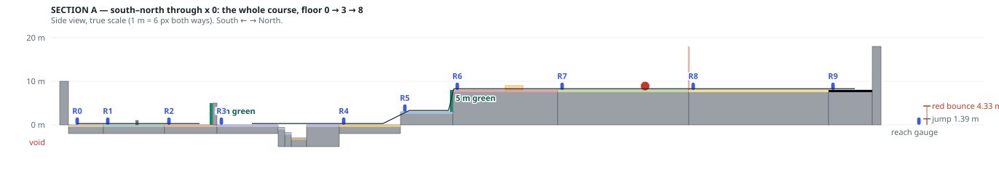

**A (south–north, x 0):** the whole course. The 1 m wall, the target wall, the blue gap with its pit and stairs back out, the 3 m red ledge, the 5 m green wall, then the hall.

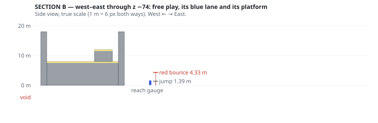

**B (west–east, z −74):** free play. The blue lane, and the platform at 4 m that red or green reaches.

---

## Room by room

### R0 — Briefing
A still: the sergeant and the player, comms bar underneath. *"The world ran out of colour. We kept what was left. Prove you can carry it."* No controls list. The level starts the moment the still is skipped.

### R1 — Move · *can I move?*
Flat, grey, and one **1 m wall** (it stops a walk at chest height, and a jump clears it). Deliberately boring: about eight seconds. **Grey slows you from the first step** (ADR-0002), so you feel sluggish before anything is explained.

### R2 — The First Splat · *what does the gun do?*

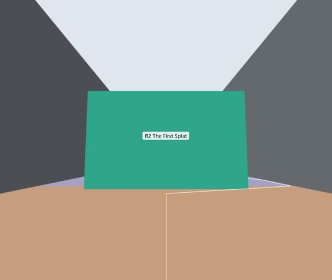

A 5 m wall straight ahead, the **only paintable surface in the room** (teal in the model). You walk round it on either side, so the colour stays in view as you pass, per v1's design note. The sergeant: *"That's colour. It changes what you can do, not just what you see."*

### R3 — Blue · *what if the ground was slippery?*

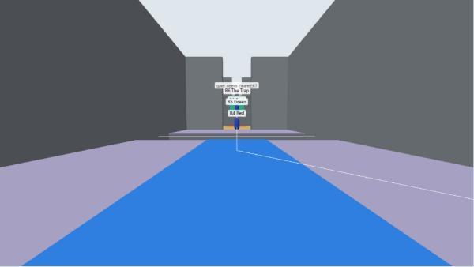

A 14 m run-up with a **blue strip already painted** down the middle, to the edge of a **6.5 m gap**. Fall in and you land in a pit 3 m down with **stairs straight back to the run-up**: no death, just another go. The test runs this with the real player code.

### R4 — Red · *what if the ground pushed back?*

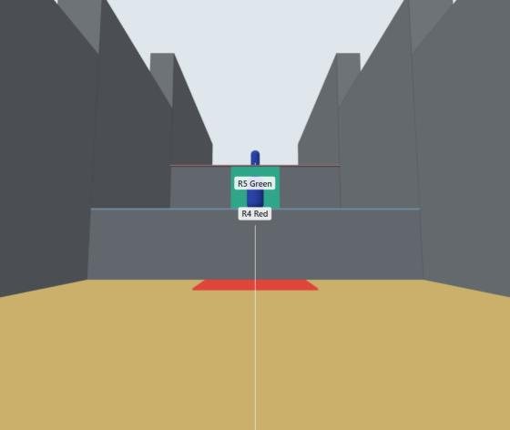

A **3 m ledge**: 1.6 m above a jump, 1.3 m inside a bounce. A **red pad already painted** at its foot. The ledge face is rock, so green can't answer the red room: one mechanic per room (tested).

### R5 — Green · *what if the wall wanted to be climbed?*

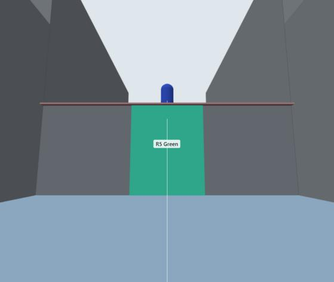

A **5 m wall**, beyond a red bounce, so only green climbs it (tested). Its strip is **not** pre-painted: the third lesson is the first one you paint yourself (Decision 3).

### R6 — The Trap · *is this place dangerous?*
A spike pit across the corridor, telegraphed (a sagging floor, a creak), that **damages and never kills**. Blue slides over it if you want. The zone is placed; the pit itself is built in the trap pass (#101).

### R7 — One of Theirs · *which colour is this?*

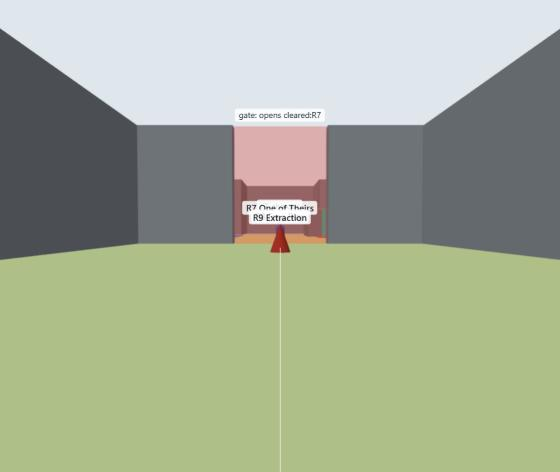

A 24 × 30 m hall and **one Charger**, dormant until you walk in. *"One of theirs. It won't stop. Make the ground stop it instead."* Blue slides it into the wall, red flings it, green stops it dead, and the tutorial never says which is right. **The gate at the far end opens when it's gone.**

### R8 — Free Play · *what can I do with this?*

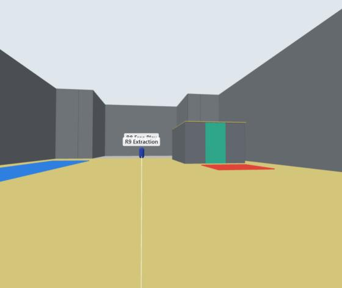

**No enemies, no objective, no win trigger** (tested: the win volume is outside it). A pre-painted **blue lane** to slide down, a **red pad** that bounces you onto a **4 m platform**, and a green strip up the platform's face for the other way. Thirty seconds of being bad at the game safely.

### R9 — Extraction
The pad beyond free play. *"You're ready. Outskirts — go."* The win needs R7's Charger gone, so the gate has opened.

---

## Nothing kills (issue #79)

- **Every wall is taller than the floor next to it plus a red bounce**, so no floor launches you out (tested, wall by wall, against the floors within 6 m of it).
- **The blue pit is enclosed and has stairs out** (tested). The first draft had two holes found by checking the data against this rule: the landing stopped 1 m above the pit floor, leaving a slot onto the void beneath, and the side walls started at floor level, leaving the pit's sides open. A test now checks every side of the pit at chest height, and it fails on the first draft (checked).
- **The only thing that hurts is the spike pit**, and it doesn't kill.

---

## Dependencies outside the levels lane

1. **#156, paintable surfaces readable.** The R2 wall and the R5 strip are the whole lesson, and in the game they look like the walls around them.
2. **#101, trap volume and spike pit.** R6's pit.
3. **#111/#112, sergeant briefing and comms bar** (UI lane) for R0's still and the lines in R2, R7 and R9.
4. **#155, tank per level.** The Primer should get a defined tank; the recommendation in #155 is Outskirts' 100.

---

## Decisions (Renda, 29 Oct: the recommended default on all five)

1. **The blue gap is 6.5 m.**
2. **Doorways between lessons.** A cross wall with a 4 m doorway at R1→R2, R3→R4 and R6→R7. R2's target wall, the red ledge and the green wall already divide their rooms. From the blue room you now see a sliver of what's next, not the next three lessons.
3. **Blue and red pre-painted, green not.** Green is the first lesson you paint yourself.
4. **Free play ships three toys** (lane, pad, platform); a gap comes after a playtest.
5. **R2's exit goes round the wall.**

## Built

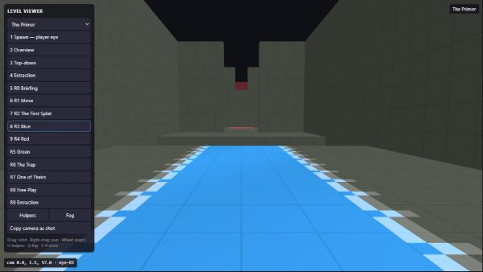

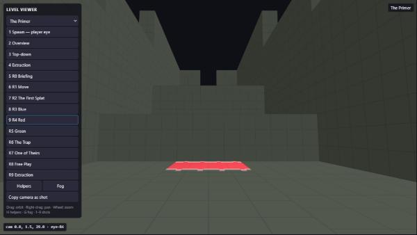

**Paint already on the floor at load** is new in the shared level code (`LayoutLevel._prepaint`). The built-level test reads the floor's physics at every pre-painted rectangle's corners and centre: the blue strip is blue (friction 0.4, speed ×1.6), the red pad bounces, and the run-up beside the strip is still grey. **It caught a real bug:** a fixed 1 m paint grid left the far edge of the 2.5 m red pad bare. The grid is now fitted to each rectangle.

**The stub level is gone.** With the Primer built, nothing used `stub-level.js`, and its own comment said to delete it when that happened. The registry's default level is still Outskirts: the Primer doesn't teach until its sergeant and trap exist, and switching the start is a campaign call.

## Deliberately undecided

The sergeant's exact lines and timings (UI lane), the trap's telegraph, mood (the Primer has none planned; it could borrow Outskirts'), props for the "rebel training course" fiction, and the tank size (#155).
