# The Ascent — Level Two

**Design v2 — 29 Oct 2026. Status: approved (Renda, 29 Oct, all five open decisions at their recommended default). The blockout is built from this data. Next: a timed playthrough.**

**Identity:** the loop with *no space*. Narrow footing, long drops, wide fights, and every splat a choice between climbing and fighting. The player is **rationing**.

---

## How this document works

v1 of this doc was a list of rooms and a top-down sketch. The blockout built from it was faithful to the sketch and still incoherent. A sketch leaves out height, sightlines, time and the player's reach, and the build has to invent all four. v2 removes the inventing:

| What | Where | Why it can't drift |
|---|---|---|
| **The layout, as data** | [`src/levels/layouts/ascent.js`](../../src/levels/layouts/ascent.js) | It's the single source of truth: every box, strip, pad, enemy and route |
| **Physics check** | [`tests/ascent-layout.test.js`](../../tests/ascent-layout.test.js) | 12 tests check the data against `config.js`: climb heights, top-out lips, stair rises, pad reach and headroom, catch floors, sightlines |
| **3D massing model** | [`docs/levels/massing/massing.html?layout=ascent`](massing/massing.html), run with `npm run dev` | Built from the data, so you can orbit it, open each room's "what you see" frame, and toggle turret ranges and sightlines |
| **Plan, sections, pacing** | [`docs/levels/ascent/`](ascent/) `*.svg` | **Generated** from the data by `render-diagrams.mjs`. Never hand-drawn, never hand-edited |
| **The playable level** | `src/levels/level-02-ascent.js` + `src/levels/layout-builder.js` | **Built from the same data file.** The builder makes no layout decisions; [`tests/level-02-ascent.test.js`](../../tests/level-02-ascent.test.js) checks the built level matches the data exactly |

**To change the level:** edit the data → `node --test tests/ascent-layout.test.js` → `node docs/levels/massing/render-diagrams.mjs ascent` → look at it in the massing model. Then this doc's words, if a decision changed.

---

## Why v2: what was wrong with v1

These were measured, not felt (see the review, 29 Oct):

1. **No goal in sight.** The lift couldn't be seen from 6 of 9 rooms; it first appeared at the top of the switchback. **v2: the lift tower is visible from 8 of 9 rooms**, including the very first frame (table below).
2. **No height.** A ground plate under everything turned every drop into a 5 m step onto the same plaza. **v2: the level stands in a void.** Every *traversal* piece has a catch floor one level down. Fights have kerbs. Some edges really kill.
3. **Crates, not a mountain.** **v2: one central peak** that steps inward as it rises, with the route spiralling up its outside.
4. **A detour with no reason.** **v2:** every turn follows the mountain's face, and the next room is visible from the current one.
5. **Too small.** 110 m of route, 16 m of climb, about 1–2 minutes. **v2: 447 m of route, 40 m of climb (56 m to the tower top), 13 enemies, about 6 minutes** for a first-timer (see Pacing for which parts are measured and which are estimated).

What v2 **keeps** from v1: the beats and their order, the turret "paint where you're watched" room, the chain over a safe switchback, the ledge Charger exam, the summit release, and every physics rule (5 m+ climb faces, 4.6 m cover, 1.2 m steps, the lip over every climb).

---

## The shape: a spiral round one peak

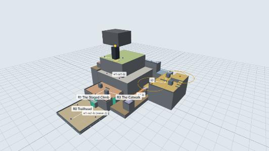

South face → east canyon → north face → west ledge → summit. Height goes **0 → 12 → 20 → 26 → 32 → 40**, and the tower top is at 56.

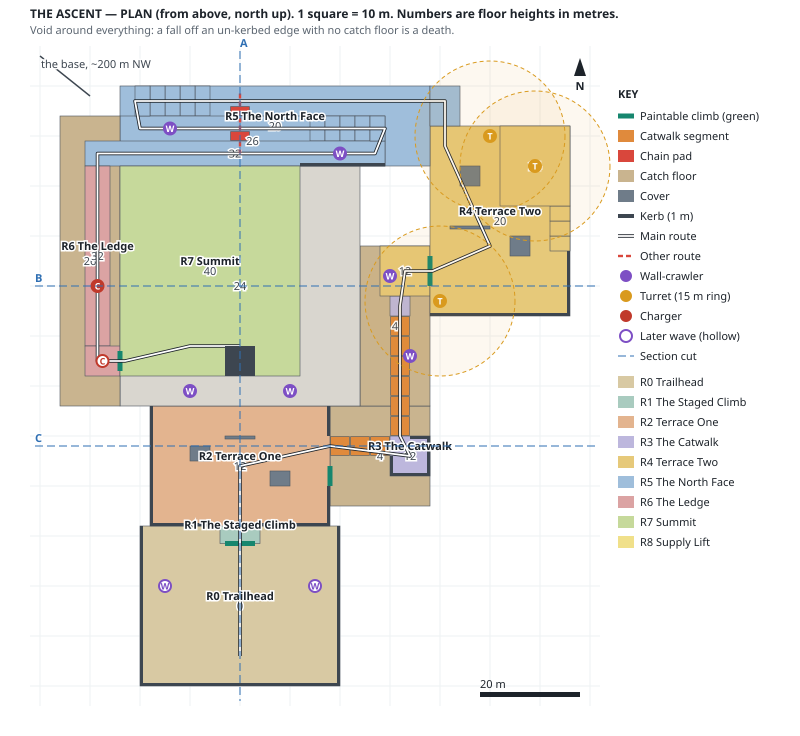

**Reading the plan.** Floors are tinted by room and labelled with their height in metres. Thick teal lines are the only paintable walls. Hollow enemy markers are wave 2. Dashed blue lines are the three section cuts below.

---

## The numbers everything is measured against

| Move or fact | Value | Source |
|---|---|---|
| Plain jump | **1.39 m** up | `PLAYER.jumpSpeed` 8.5, `gravity` −26 |
| Red bounce | **4.33 m** up | `PLAYER.minBounce` 15 |
| Green climb | **4.5 m/s** | `PLAYER.climbSpeed` |
| Top-out lip | **0.3 m** past every climb face | Measured minimum (Outskirts). No mantle, so the lip stays, kept at the minimum |
| Wall contact | at **chest height**, 0.85 m above the feet | `player.js` `_resolveWalls`. So a **1 m kerb** stops a walk and a jump clears it |
| Walk speed on grey | **4.2 m/s** (7 × 0.6) | `PLAYER.maxSpeed` × `SURFACE.grey.standSlow`. On your own paint it's 7 |
| Tank | **60 ink = 15 shots** | `AMMO[2]` 60, `PAINT_GUN.cost` 4 (*see Dependencies: not wired yet*) |
| Splat | **2.8 m** across | `PAINT_GUN.radius` 1.4 |
| Refill | **8 ink/s**: empty to full in **7.5 s** standing in your paint | `PAINT_GUN.refillRate` |
| Turret reach | **15 m** | `ENEMY.turret.attackRange` |
| Crawler climb | **any** wall: 3.5 m/s on grey, 5.0 on green | `CLIMB` |

**So:** a 6 m climb costs **about 3 shots** of green (stacked 2.8 m splats), and an 8 m climb 3–4. **Every climb face is 6 or 8 m**, beyond a red bounce, so green is the only answer on a climb, by design.

---

## Pacing

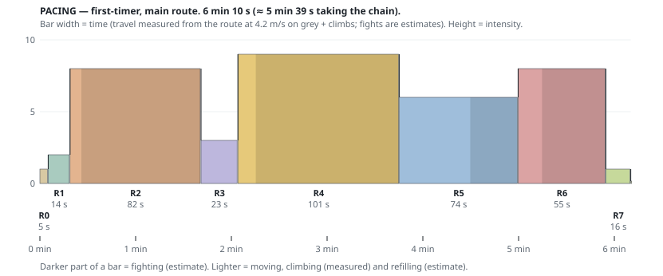

| Room | Moving + climbing (**measured**) | Refilling / looking (**estimate**) | Fighting (**estimate**) | Total |
|---|---|---|---|---|
| R0 Trailhead | 5 s | — | — | 5 s |
| R1 The Staged Climb | 8 s | 6 s | — | 14 s |
| R2 Terrace One | 7 s | — | 75 s | 82 s |
| R3 The Catwalk | 11 s | 12 s (the vista) | — | 23 s |
| R4 Terrace Two | 11 s | — | 90 s | 101 s |
| R5 The North Face | 44 s | — | 30 s | 74 s |
| R6 The Ledge | 15 s | — | 40 s | 55 s |
| R7 Summit | 6 s | 10 s | — | 16 s |
| **Total** | **107 s** | **28 s** | **235 s** | **≈ 6 min 10 s** (≈ 5 min 39 s by the chain) |

Measured travel assumes **grey ground the whole way**, which is the slowest case: painting your own path makes you faster. The fight and dwell numbers are design estimates. **The first playtest replaces them.**

**What the chart says, and what to do about it:**

- **R2 → R3 → R4 was high, a 10-second dip, then the highest.** Ten seconds isn't a rest. "Alternate highs and lows" (`docs/level-design-principles.md`) needs a real breather. **Fixed (decision 1):** rest pillar 1 is now the **vista**, a kerbed balcony 30 m from turret t0 (out of its reach, tested). R3 is now 23 s at intensity 3.
- **R4 is a 90-second plateau.** Inside the room it needs a shape (see the R4 encounter script: the crawlers arrive *after* you've engaged the turrets), not one flat block of turret fire.
- **Act 1 (R0–R1) is 19 s.** That's right for a level that's second in the campaign: you're up the first face inside 20 seconds, but with a choice already made (see R0).

---

## Sections — the heights at true scale

Every section has a **reach gauge**: a 1.7 m player with jump and red-bounce heights at the same scale. Any wall can be compared to it by eye.

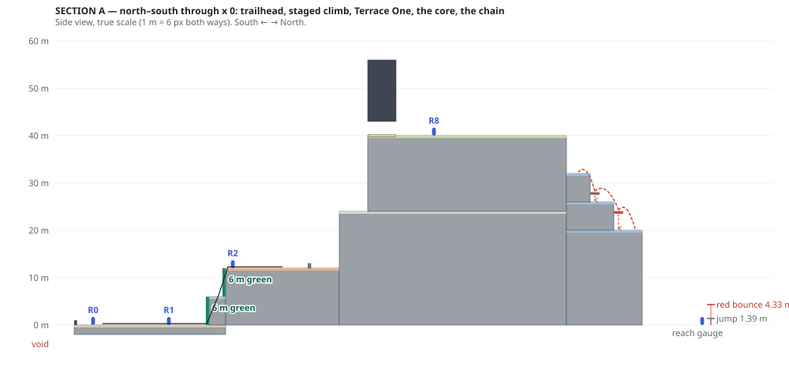

**A (north–south, x 0).** The whole climb in one picture: trailhead → two 6 m green faces with the rest ledge between → Terrace One → the shoulder → the summit and tower. On the right are the three red bounces of the chain up the north face, each landing above a switchback leg.

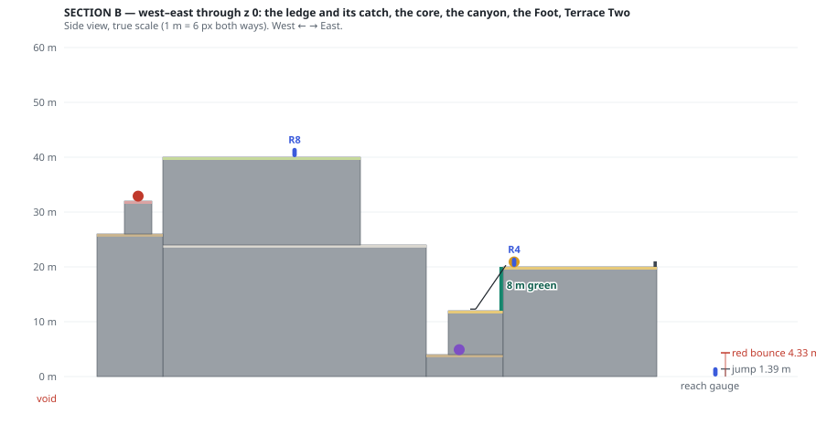

**B (west–east, z 0).** The ledge as a free ridge with its catch shelf 6 m below, the peak, the east canyon with its scree floor, the Foot, and the 8 m green climb up to Terrace Two under turret t0.

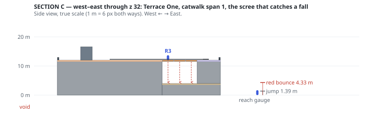

**C (west–east, z 32).** Terrace One and catwalk span 1. The dashed arrows are where a fall off each segment lands: the scree, 8 m down, never the void.

---

## Room by room

Each room card answers the questions from the sketch rubric (`docs/level-design-principles.md`). The frame is what you see on arrival, at 1.5 m eye height, rendered from the data.

### R0 — Trailhead · y 0

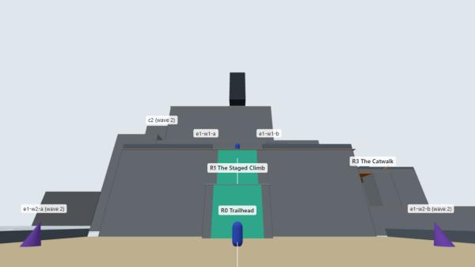

- **Question:** *where am I going?*
- **What you see:** the peak, the **lift tower on top** (the goal, visible from the first frame), and two teal strips straight ahead: the way up. On the left and right edges are two **dormant wall-crawlers** (wave 2).
- **The decision:** shoot the dormant crawlers now (paint you need for the climb, from a 15-shot tank), or leave them. They wake when Terrace One's wave 1 dies and **climb up your own green** behind you. Under the dormant-enemy rule (DECISIONS, 24 Oct) they stay visible; hiding them would be a reveal and remove the choice.
- **Lazy player:** walks past them and gets flanked on Terrace One. That's the lesson, not a failure of the room.
- **Fail-forward:** kerbed on every side.
- **Disproved if:** players don't notice the crawlers at all. Then they're scenery, not a decision. Two-minute test: watch where a first-timer's camera goes in the first 10 s.

### R1 — The Staged Climb · y 0 → 6 → 12

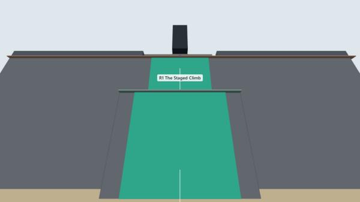

- **Question:** *can I get up there on one tank?*
- **Why this room exists:** the Primer and Outskirts already taught "green climbs". This room teaches the Ascent's own rule, **rationing**. Two 6 m faces (≈3 shots each) with a **rest ledge** between. Paint the ledge, stand in it, refill, then climb again. Old verb, new budget.
- **Built from:** `rest-ledge`, strips `face-a`, `face-b`, and Terrace One's 0.3 m lip.
- **Paint:** about 7 shots in all, never more than 4 before you can refill. **Recoverable.**
- **Fail-forward:** a fall from face B lands on the rest ledge (costs one stage); a fall from face A lands on the trailhead.
- **Disproved if:** players paint both faces from the ground without using the ledge. Then the stages are cosmetic. Fix by making face B start further back.

### R2 — Terrace One · y 12 · *Encounter 1*

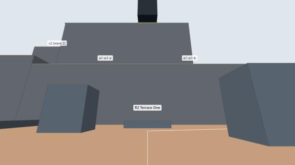

- **Question:** *will you paint a route something else can use?*
- **Space:** 36 × 24 m. Two 4.6 m cover blocks and a 1 m hop-over wall. Kerbed edges. Behind it, a **12 m rock face** up to the shoulder.
- **Enemies (one type, two waves):**
  - **Wave 1:** two wall-crawlers on the shoulder, **visible on arrival**. They come *down the mountain* at you.
  - **Wave 2:** the two from the trailhead. They wake when wave 1 dies and **climb your R1 green**, faster than on rock (5.0 vs 3.5 m/s), arriving behind you.
- **Foothold:** the R1 top-out lip, with the low wall 16 m ahead as the first cover.
- **Lazy player:** stands at the top-out and shoots down the face as wave 2 climbs. Allowed, but it means standing on the kerb line with wave 1's survivors behind you. Make sure wave 1 is actually dead before wave 2 wakes.
- **Exits:** the catwalk (east). The way back down is the R1 faces.
- **Paint:** combat about 8–10 shots, refilled on the big floor. **Recoverable.**

### R3 — The Catwalk · y 12 · *traversal under watch*

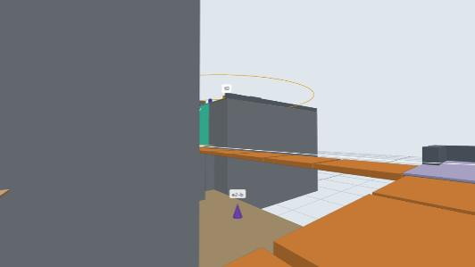

- **Question:** *can you cross before it drops, and while you're watched?*
- **Space:** span 1 (12 m east, 3 segments), then **the vista**, then span 2 (24 m north up the canyon, 6 segments), rest pillar 2, then the Foot. Segments collapse in the **trap pass** (#102); in the blockout they're static.
- **The vista** (decision 1): an 8 × 8 m kerbed balcony and **the only safe stop between the two biggest fights**. It's 30 m from turret t0, out of its 15 m reach (tested). Refill here, look back over Terrace One, and look up the canyon at the turret you're about to walk under. Rest pillar 2 couldn't be the breather: it sits inside t0's ring.
- **What you see:** **turret t0** on Terrace Two's corner, *before it can fire* (the fairness rule). Its 15 m ring covers the last segments, the Foot and the Foot's climb. The teal climb is visible too: the next goal is in sight.
- **Answers:** blue runway (2–3 shots, fast), or run it free.
- **Fail-forward:** a fall lands on the **scree**, 8 m down. The `scree-return` strip (8 m green) climbs back up to Terrace One's east side. Cost: time and about 3 shots.
- **Pacing:** 23 s at intensity 3, a real low between R2 and R4.

### R4 — Terrace Two · y 20 · *Encounter 2*

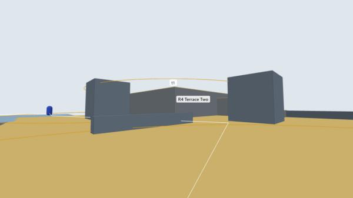

- **Question:** *can you make paint where you're being watched?*
- **Arrival:** the 8 m `foot-climb` strip, **under turret t0**. You paint the only way up where a turret can see you. That's the room's question, asked before you've even arrived.
- **Space:** 28 × 38 m. A **high deck** at y 24 (reached by green, red or three 1 m steps). A safe pocket behind a 4.6 m rock. Lanes split by a 1 m low wall and a second rock (added after the massing review: the first pass was an empty flat under three turrets, which is exposure, not a decision).
- **Enemies (two types):** turrets t0 (above the Foot), t1 (high deck), t2 (the north exit). Turrets have **no colour effects**, so the only counter is position. Two wall-crawlers wake on the scree when you top out and climb the massif to **flank you while you're pinned** by turrets.
- **Paint:** the climb (3 shots) plus refilling in the open. **This is the one intentionally unrecoverable room**: if you run dry anywhere, it should be here, and it should be because you painted in the open.
- **Exit:** the north-west corner, onto leg 1.

### R5 — The North Face · y 20 → 32 · *the choice*

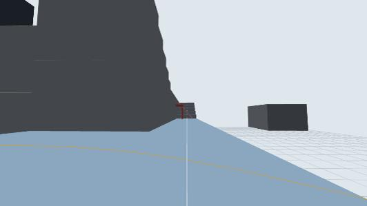

- **Question:** *will you commit to the chain, or take the long way?*
- **The long way (switchback):** leg 1 (y 20, west), five 1.2 m steps, leg 2 (y 26, east), five steps, leg 3 (y 32, west). About 168 m, slow and exposed on its open north edge. **Boulders** roll down it in the trap pass (#104).
- **The chain:** paint leg 1 red, bounce to **pad 1** (y 24), then **pad 2** (y 28), then onto **leg 3** (y 32). Three bounces of 4 m each (red reaches 4.33). A missed pad lands on the leg below it (tested), and each pad has 2 m+ of headroom over its leg so walking the switchback never puts your head through one. About 3 shots, and it **saves about 30 s**.
- **Enemies:** two wall-crawlers on legs 2 and 3. They can take the face faster than you can, which is the one place a crawler should frighten you.
- **Readability:** from the R5 arrival point the chain is **41 m away**. Decision 2 gave the pads Corp scaffold posts. The frame shows they help, but **at 41 m they're still small**. The props pass has to make the chain a landmark (a tall frame, a lit marker), not just mark it. Re-check this frame after the props pass.

### R6 — The Ledge · y 32 · *the exam*

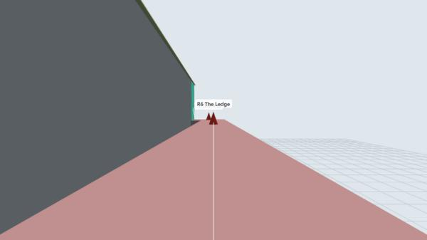

- **Question:** *how do you beat a Charger with nowhere to sidestep?*
- **Space:** a **5 m wide free ridge**, 36 m long, with a 2 m gap to the peak on one side and open air on the other. The **catch shelf** is 6 m below along its whole length and joins leg 2, so a fall costs leg 3 again, not the run.
- **Enemies:** two Chargers, **one after the other**: the second wakes when the first is gone. Blue on its line sends it **off the ridge**, which counts as the clean kill. Red bounces you over it. A green pin stops it at the cost of standing still. Pendulum blades (#103) arrive in the trap pass.
- **What you see:** the Chargers, and at the far end the **teal final climb**. The room's goal is visible from its start.
- **The final climb:** 8 m of green up the peak's west face, with whatever paint you have left. The ledge is paintable, so you can refill first.

### R7 — Summit · y 40 · *release*

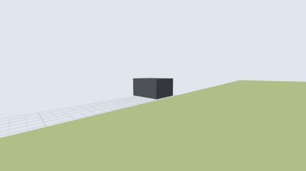

- **Question:** *why are we doing this?*
- No enemies, no traps, no paint needed. Corrupt Corp's **base on the north-west horizon**, about 200 m away, sightline tested. Behind you, the whole spiral you just climbed. The sergeant's one line goes here.
- **Do not put anything in this room.**

### R8 — Supply Lift

The cage at the tower's foot is the extraction, on the far side of the summit from where you arrive, so **you get the view first** (#95). It only takes you down once the ledge is clear.

---

## Encounter scripts

| Enemy | Type | Starts | Wakes when | Note |
|---|---|---|---|---|
| e1-w1-a, b | wall-crawler | shoulder above Terrace One | you enter R2 | Comes **down** the 12 m face |
| e1-w2-a, b | wall-crawler | trailhead edges (dormant, visible) | wave 1 is dead (or you shoot them) | Climbs **your** R1 green |
| t0 | turret | Terrace Two, above the Foot | always | Watches the catwalk end and the Foot climb |
| t1 | turret | the high deck | always | Overwatches the arena floor |
| t2 | turret | the north exit | always | Covers the way onto leg 1 |
| e2-a, b | wall-crawler | the scree, below the massif | you top out on R4 | Climbs the massif to flank you |
| r5-a, b | wall-crawler | legs 2 and 3 | you enter R5 | Faster on the face than you |
| c1 | charger | mid-ledge | you enter R6 | |
| c2 | charger | ledge end, by the final climb | c1 is dead or off the ledge | |

**13 enemies, 3 types.** The cast follows DECISIONS 2026-10-06 (L2 = wall-crawler + turret) plus the ledge Chargers from the original design. No new enemy types.

**New level logic this needs:** a "wakes when another group is cleared" trigger (wave 2, c2). Outskirts only wakes on entering a room. It's a small extension of the same sleeper list, in the levels lane.

---

## Fail-forward

| You fall from | You land on | It costs |
|---|---|---|
| R1 face B | the rest ledge | one climb stage |
| R1 face A | the trailhead | the first stage |
| A catwalk segment | the scree, 8 m down | the `scree-return` climb (8 m, about 3 shots) and the catwalk again |
| The Foot climb | the Foot | the climb again, under t0 |
| A chain pad | the switchback leg below | that leg, or the bounce again |
| Leg 1's open north edge | **the void, which is a death** | the run. It's the "exposed" identity, and it's the long way's risk (decision 4) |
| The ledge | the catch shelf (y 26), which joins leg 2 | leg 3 and the ledge again |
| Kerbed edges (trailhead, terraces) | nothing: the kerb stops a walk-off; jumping it is your choice | — |

---

## Traps (pass 2: placements only, built after all four blockouts)

| Trap | Where | The answer it must allow |
|---|---|---|
| Collapsing catwalk (#102) — **built, polish pass 1** | spans 1 and 2 | Blue to cross fast, or nerve |
| Rolling boulder (#104) — *Parked* | down legs 2 and 3 | The chain outruns it |
| Pendulum blades (#103) — *Parked* | across the ledge, two | Standing still to pin a Charger costs something |

---

## What the tools have already checked

`tests/ascent-layout.test.js`, 14 tests, all passing against the data:

every climb is taller than a red bounce · every climb has a floor below and a 0.3 m lip above · every climb strip is on a real face · every stair step is under a plain jump · every chain bounce is within red reach and above a jump, with headroom and a floor under each pad · cover is taller than a red bounce, and low walls are hop-able · kerbs stop a walk and allow a jump · every catwalk segment and the ledge has a catch floor · every enemy and every route point stands on a floor · no two boxes overlap · the vista is out of every turret's reach · the lift tower is visible from the trailhead · the base is visible from the summit.

`tests/level-02-ascent.test.js`, 9 tests, the **built** level against the data: every strip is built as paint at exactly its size, and no other wall takes paint · no two surfaces share a plane (no z-fighting, no doubled collider) · no wall faces into rock · every walkable top is a floor · turrets start awake and the rest wait · Terrace One's waves trigger in order · the second Charger waits for the first, the lift waits for both, and it wins once · ten reloads leak nothing.

**Sightlines to the lift tower** (generated, `ascent/timings.json`):

| R0 | R1 | R2 | R3 | R4 | R5 | R6 | R7 | R8 |
|---|---|---|---|---|---|---|---|---|
| ✅ 76 m | ✅ 65 m | ✅ 47 m | ✅ 45 m | ✅ 54 m | ✅ 75 m | ❌ peak in the way | ✅ 22 m | ✅ 17 m |

R6 is the exception, and it's acceptable: the room's own goal (the final climb) is in view from its start.

**What the tools can't check:** whether any of it is *fun*. Fight times are estimates. Whether the chain feels like commitment or a coin flip, and whether the R0 dormant crawlers read as a choice, are playtest questions.

---

## Dependencies outside the levels lane

1. **The Ascent's tank isn't wired (core, Ozuko).** `main.js` creates the paint gun with level `1` hard-coded, so every level gets Outskirts' 100 ink. The Ascent's identity, rationing on 60 (15 shots), doesn't exist in the game until `main.js` passes the level's number. One line; needs an issue.
2. **Paintable and rock walls look identical** (BACKLOG, 29 Oct). Every room here depends on the player finding the teal strips. In the massing model they're teal; in the game they're grey like the rock. Needs a readability decision (#126 or a level-side marker) before the Primer.
3. **Wall-crawlers climb any wall.** Kept, by Renda's decision (29 Oct): green makes them faster, it doesn't make the route theirs.

---

## Decisions (Renda, 29 Oct: the recommended default on all five)

1. **The catwalk breather:** a vista balcony. It went on **rest pillar 1, not 2**, because pillar 2 turned out to be inside turret t0's range. R3 is now 23 s at intensity 3.
2. **The chain's visibility:** Corp scaffold posts on the pads. They help, but not enough at 41 m (see R5); the props pass finishes the job.
3. **Wave 2 stays dormant and visible** on the trailhead: a rationing choice in the first 10 seconds.
4. **Leg 1's north edge stays a real drop**, the long way's own risk.
5. **About 6 minutes:** build and time a real playthrough before adding content.

## What building it caught

Building the level from the data, and testing the build against the data, found five things the drawings and the massing model couldn't. All are fixed, and each now has a test so it can't come back:

| Found | Why it mattered | Fix |
|---|---|---|
| **The catch shelf counted as part of the ledge** | A Charger knocked off the ridge "was still on the ledge", so the ledge never cleared and **the lift never left**: a soft-lock | Catch floors are no longer part of any room (a fall puts you *out* of the fight) |
| Terrace One's east lip ran under the first catwalk segment | Two floors in one plane: z-fighting | A slab replaces the floor under it |
| Terrace Two's west lip ran under leg 1's floor | The same | A lip never overlaps another top at the same height |
| A kerb meant for leg 2 sat **inside leg 3** | A wall buried in rock | Moved to leg 3's south edge, the real drop (8 m to the shoulder, or the void past x 24) |
| Kerbs overlapped at eight corners | Doubled walls | Trimmed to meet; a layout test now rejects any box overlap |

**And one it confirmed:** in the built level **the climb strips are invisible**. The game draws them grey like the rock (Dependency 2), so the only way to find one is to shoot the wall:

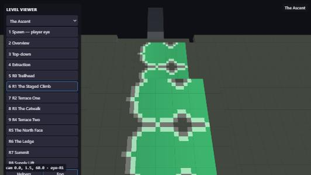

The paint is refused on the rock and lands only on the two strips, exactly their size. The level is right; the readability isn't there yet.

## Polish pass 1 (30 Oct 2026)

Pass question: *does the climb feel like rationing, and is the goal always in view?* Tests: `tests/ascent-polish.test.js`.

- **The collapsing catwalk (#102)**, `src/levels/catwalk.js`. Each segment falls 0.9 s after you first step on it, whether or not you are still there: at full speed a 4 m segment takes 0.57 s, so a run always makes it and a stop to shoot never does. It shakes and flashes amber on its walking surface while it goes, lands you on the scree, and reforms after 5 s (never into you). Numbers in `ASCENT.catwalk`.
- **The chain landmark (R5)**: a Corp scaffold gantry over the two pads, masts 2.6 m off the chain's line, cold-white floodlights at 44 m that read from R5's entrance 41 m away, and a lit bollard on each pad that reads from the stop before it. Built from the Corp prop kit (`prop-kit.js`, new `floodlight` kind: white means "here", amber still means "this hurts").
- **The base on the horizon**: three towers and the Siphon's stack, an unfogged dark silhouette from the summit, sunk to −120 m so it rises out of the dark band.
- **Cold dawn (#125)**: `ASCENT.mood`, pale rose-grey horizon, slate-blue zenith, fog 30–170 m so the lift beacon reads the whole climb.
- **Parked:** rolling boulders (#104) and pendulum blades (#103).

## Deliberately undecided

Turret facing and fire rates, every combat paint number, the sergeant's line, and what the lift ride looks like. Those are the campaign-wide passes.

## Curves, flat versus smooth (#198)

The supply lift's two haul cables sag from the lift tower down to the trailhead, so from the first frame they lead the eye up to the goal. The rock scree and the gantry are flat-shaded, as rough rock and Corp steel; the cables and the paint are smooth.
