# Last Colour — Level Three

**Design v2 — 29 Oct 2026. Status: approved (Renda, 29 Oct, all five decisions at their recommended default). The blockout is built from this data. Next: a timed playthrough.**

**Identity:** the loop *under attack*. Your paint is territory you can lose. Two levels taught the player that paint is safety; this one takes it back. Painting makes you stronger, and **the enemy eats your paint**.

---

## How this document works

The same way the Ascent's does (`docs/levels/02-the-ascent.md`): the level is **data**, and everything here is generated from it.

| What | Where |
|---|---|
| **The layout, as data** | [`src/levels/layouts/last-colour.js`](../../src/levels/layouts/last-colour.js) |
| **Physics check** | [`tests/last-colour-layout.test.js`](../../tests/last-colour-layout.test.js): 10 tests, all passing |
| **3D massing model** | [`docs/levels/massing/massing.html?layout=last-colour`](massing/massing.html) (run `npm run dev`) |
| **Plan, sections, pacing** | [`docs/levels/last-colour/`](last-colour/), generated by `node docs/levels/massing/render-diagrams.mjs last-colour` |
| **The playable level** | `src/levels/level-03-horde.js`, a `LayoutLevel` (shared with the Ascent), **built from the same data**; [`tests/level-03-last-colour.test.js`](../../tests/level-03-last-colour.test.js) checks the build against it |

---

## What v2 keeps, and what it adds

v1 of this doc had the right **beats** and they all stay: the hangar's six Drainers, the corridor squeeze, the Core's two waves with the first Stalker, Big Arm, and the Siphon as a three-colour exam. It had no **space**, so v2 adds three spatial ideas:

1. **The Siphon is the goal you can see.** Lift, hangar, corridor and Core sit on **one north–south axis**. The Siphon closes the view down the corridor, and a **beacon on a mast at 27 m** shows over the hangar's 12 m wall from anywhere on the arrival landing (tested from every corner).
2. **High ground is the only safe paint.** Drainers, Stalkers and Chargers **cannot climb** (`climbsGreen: false` in `config.js`), so any raised platform is paint nothing can eat. That turns v1's rule ("a paintable pocket within 5 seconds, every 30 seconds of combat") into geometry, and **every point of both arena floors is within a 5-second walk of a climb to one** (tested; worst point 19.4 m against a 21 m limit). In wave three, turrets on the balcony take that safety away.
3. **The next wave is visible.** Waves come out of side bays behind see-through gate fields, and wave three waits, dormant and visible, behind wave two.

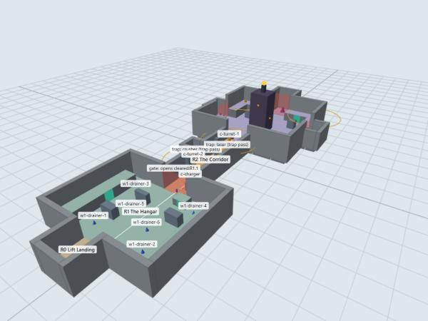

---

## The plan

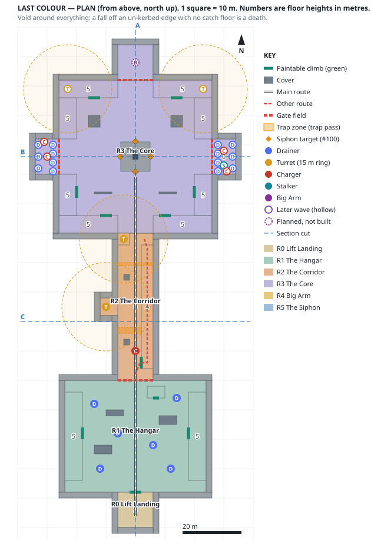

Floors are tinted by room, numbers are floor heights, thick teal lines are the only paintable walls, red dashed lines are gate fields, amber zones are traps (built in the trap pass), and amber diamonds are the Siphon's phase targets (#100). Hollow enemy markers are later waves; the dashed one is Big Arm, which is placed but not built (#99).

---

## The numbers everything is measured against

| Move or fact | Value | Source |
|---|---|---|
| Plain jump | **1.39 m** | `PLAYER.jumpSpeed`, `gravity` |
| Red bounce | **4.33 m** | `PLAYER.minBounce` |
| Climbable top-out lip | **0.3 m** | No mantle (#157 is a COULD) |
| Walk speed on grey | **4.2 m/s** | `PLAYER.maxSpeed` × `SURFACE.grey.standSlow` |
| Tank | **80 ink = 20 shots** | `AMMO[3]`, `PAINT_GUN.cost` 4 (*not wired: #155*) |
| A Drainer eats | **1 m² of your paint per second** while it feeds | `ENEMY.drainer.drainRate` 16 cells/s at 4 cells/m |
| A Drainer stands up to hunt | inside **8 m**; goes back to feeding past **14 m** | `huntRadius`, `resumeRadius` |
| A Stalker runs | **6.0 m/s on your paint, 2.0 on grey** | `STALKER` |
| Turret reach | **15 m** | `ENEMY.turret.attackRange` |
| Who climbs | **nobody in this level** except you | `climbsGreen: false` for Drainer, Stalker, Charger |

**What those mean for the space:**
- **Every raised platform is 3.5–5 m**: above a jump, so it takes a climb (or a red bounce for the 3–4 m ones), and above what any enemy here can reach.
- **Every wall is at least 10 m**, and the highest floor is 5 m, so no floor plus a red bounce gets over a wall. The level is sealed (tested).

---

## Pacing

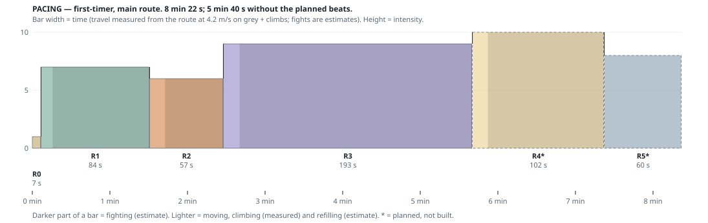

| Room | Moving (**measured**) | Dwell (**estimate**) | Fighting (**estimate**) | Total |
|---|---|---|---|---|
| R0 Lift Landing | 2 s | 5 s | — | 7 s |
| R1 The Hangar | 9 s | — | 75 s | 84 s |
| R2 The Corridor | 12 s | — | 45 s | 57 s |
| R3 The Core (waves 2 + 3) | 5 s | 8 s (the breath before wave 3) | 180 s | 193 s |
| R4 Big Arm *(planned, #99)* | — | 12 s (its gate's warning) | 90 s | 102 s |
| R5 The Siphon *(planned, #100)* | — | — | 60 s | 60 s |
| **Total** | **28 s** | **25 s** | **450 s** | **≈ 8 min 22 s** (≈ 5 min 40 s without the planned beats) |

This is an arena level: 115 m of route and almost all of its time is fighting. **Only the 28 s of movement is measured; the rest is estimate until a playtest.**

**What the chart said: there was no low after the landing.** Hangar 7, corridor 6, **three minutes at 9** in the Core, Big Arm at 10, the Siphon at 8. A finale is allowed to climb, but a player who never gets a breath can't notice the Stalker's trick or the Siphon's order, and those are the two things this level is *for*.

**Fixed (decision 1): two breaths.** Wave 3 waits **8 s** after wave 2 is gone, and Big Arm's gate **pulses for 12 s** before it drops: time to repaint, and a warning that something is coming. Both are tested on the built level. The bars can't show a dip *inside* a room, so they appear as the lighter dwell part of R3 and R4.

---

## Sections — at true scale

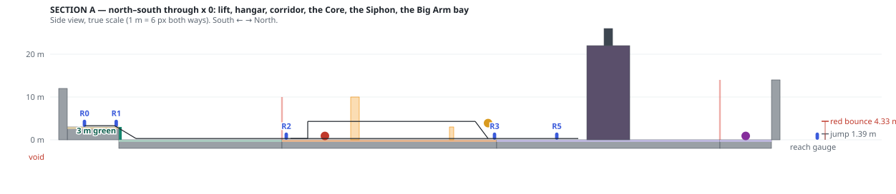

**A (north–south, x 0)**: the whole axis. The landing 3 m above the hangar (with its 3 m green climb back), the corridor and the flank route on the walkway at 4 m, the Core, and the Siphon (22 m) with its mast and beacon (27 m), then Big Arm's bay.

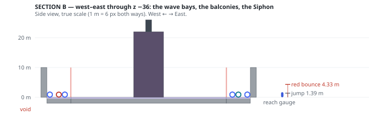

**B (west–east, z −36)**: the Core's width. The two wave bays behind their gate fields, the 5 m balconies either side, the Siphon in the middle.

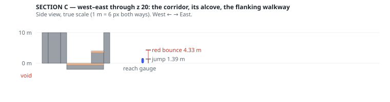

**C (west–east, z 20)**: the corridor in cross-section. T2's alcove, the floor lane, and the flanking walkway at 4 m against the east wall.

---

## Room by room

### R0 — Lift Landing · y 3

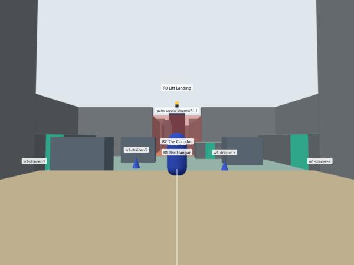

- **Question:** *where is it?*
- **What you see:** the hangar below, its six dormant Drainers, the gantries' green climbs left and right, the corridor gate dead ahead, and **the Siphon's beacon above it**. That's the whole level in one frame.
- **Why 3 m up:** a one-way vantage ("a vista with a one-way entrance", LDB). You survey before you commit. It's also a pocket: a 3 m green strip (or a red bounce) gets you back up.
- **Continuity:** you arrive by the Ascent's supply lift.

### R1 — The Hangar · y 0 · *wave one*

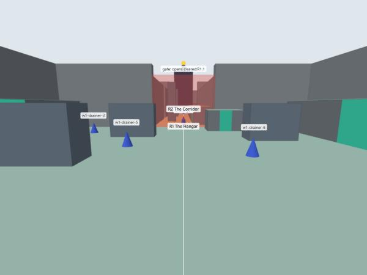

- **Question:** *why is my ground disappearing?*
- **Space:** 48 × 38 m. Three 4.6 m containers (cover, never a perch). Two **gantries** along the long walls at 5 m and a **booth** by the corridor mouth at 3.5 m: the three pockets.
- **Enemies:** six Drainers, nothing else (#96). They wake when you drop in.
- **The lesson:** paint a field, watch it get eaten, repaint. Then notice that the paint **on the gantry survives**. That second realisation is what sets up the Core.
- **Lazy player:** stands on a gantry and shoots down. Allowed, and right: it's the level's rule, discovered early. Drainers still eat the floor, so the floor still has to be retaken to move on.
- **Why the booth exists:** without it, the north end of the floor is 25 m from the nearest climb, over the 5-second rule. The test fails if it's removed (checked).
- **Exit:** the corridor gate drops when all six are gone.

### R2 — The Corridor · y 0 · *the squeeze*

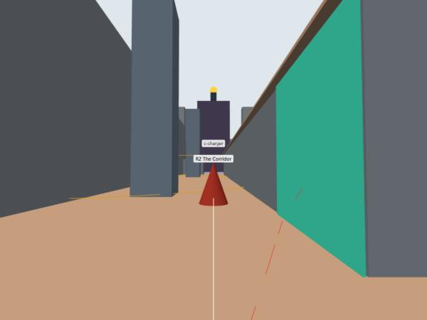

- **Question:** *can I fight without room to repaint?*
- **Space:** 12 × 50 m between 10 m walls. Two pillars, T2's alcove in the west wall, T1's platform beside the Core door, and a **flanking walkway** at 4 m along the east wall.
- **Enemies:** two turrets and one Charger, no waves (#97). The turrets deny sightlines rather than the path, and the walkway flanks both.
- **Trap (built, polish pass 1):** a **cargo crusher** across the floor lane, x −6 to 2, z 22–24 (`src/levels/crusher.js`). It slams on a fixed 3.6 s rhythm (down 1.2 s, 40 damage), and its amber lamp blinks for 0.7 s before every drop. Three answers: cross in the gap, stand on **blue** and slide under it (the Primer's spike-pit rule: blue means one thing), or take the walkway beside it. Tested in `tests/last-colour-polish.test.js`.
- **The laser grid is parked** (BACKLOG): the crusher is the trap with a rhythm, and one trap per corridor reads better than two. Its zone stays in the data, marked `planned`.
- **What you see:** the Siphon and its beacon closing the corridor's end. The goal is never out of frame.

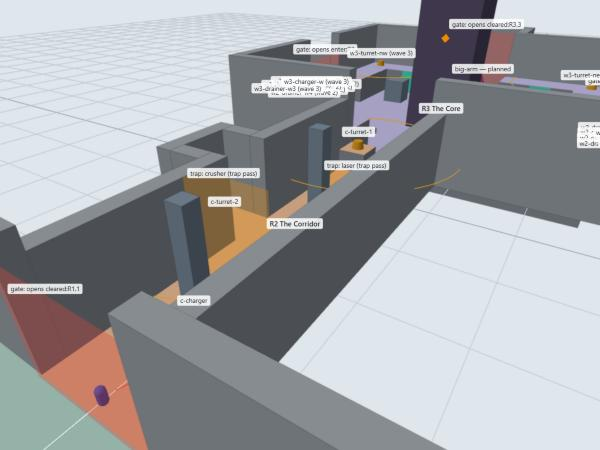

### R3 — The Core · y 0 · *waves two and three*

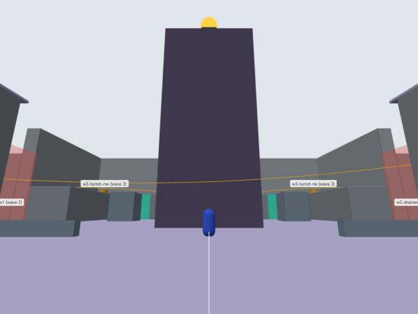

- **Question:** *can I hold ground and fight at the same time?*
- **Space:** 52 × 52 m. The Siphon in the middle (architecture and cover until #100), a **ring balcony at 5 m** with six green climbs, two low walls and two blocks on the floor. Three bays: west and east for the waves, north for Big Arm.
- **Wave two** (#98): eight Drainers, two Chargers and **the first Stalker, alone from the east bay**. Both side bays open as you walk in.
- **Wave three:** six Drainers and two Chargers, already standing at the back of the same bays, plus **two turrets that wake on the north balcony**. They come in **8 s after wave two is gone**: the breath between waves. They take away the safety of the high ground the hangar taught you to trust.
- **The Stalker:** it's fast only on *your* paint. With the balconies painted and the floor eaten, the player's safe ground and the Stalker's fast ground are the same ground. The escape is grey. That inversion is the level's best idea, and it should be discovered, not explained.
- **Retreat:** the corridor stays open behind you (Decision 2).

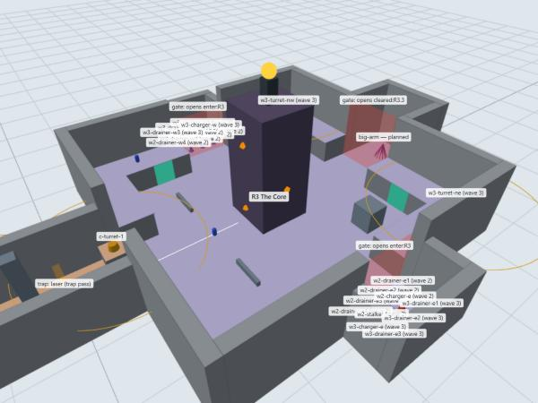

### R4 — Big Arm *(planned, #99, a cut candidate)*

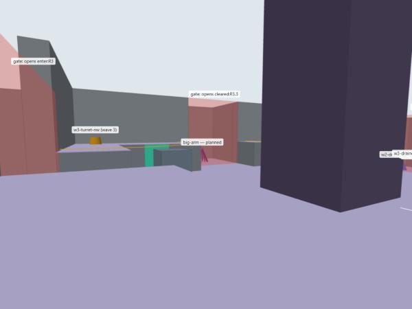

- Enters from the north bay **12 s after wave three is gone**, while its gate field pulses as the warning. Its behaviour (slam that greys 4 m, grab, enrage, dies to a three-colour combo) is #99. **The bay is built either way.** If Big Arm is cut, the bay stays shut and the Siphon follows wave three directly.

### R5 — The Siphon · *the final exam (#100)*

- **Question:** *do you know what each colour does?* Not "do you have enough paint", and not "can you out-damage a health bar". Three colours, in the order the campaign taught them, no new verb.
- **When:** the moment the Core is clear (wave three gone; Big Arm stays cut, so the bay stays shut). No enemies during the exam: it's the low after three minutes at 9, and a player under fire can't think about colour.
- **The three phases**, each a paintable plate on the Siphon that reads by **share of the plate in the right colour**, like Outskirts' vent. Damage does nothing, and nor does the wrong colour:

| Phase | Target | Colour | What solving it looks like |
|---|---|---|---|
| 1 · Intake | 3 × 3 m plate, low on the south face (y 1.5–4.5), pulling | **Blue** freezes it | the vanes stop, the frame goes frost-white |
| 2 · Arms | three 2 × 2 m plates on beams (west, east, north, y 8), **thrashing** up and down | **Green** pins each | that arm stops dead; all three pinned ends the phase |
| 3 · Core | 2.5 × 2.5 m plate high on the south face (y 16), behind a shutter until now | **Red** knocks it | the core is driven back into the machine, the beacon dies, then the win |

- **Give the tell, then the test** (the issue's design note). Each phase opens with a **reveal**: the target appears (the shutter lifts, the arms swing out) and its frame pulses **in the colour it wants** for 2 s, while it refuses paint. Then it accepts paint. A target never exists before its phase, so the exam can't be done out of order or pre-painted.
- **The leak: knowledge, not ammunition.** As each phase opens, the Siphon **spills a pool of that phase's colour** at its foot: the colour it's choking on, coming back out. Standing in it refills you (any of your paint does), and it's a second, louder tell of which colour comes next. A player who arrives dry can still finish. This is the same principle as Splatoon's ink refill points in a final stage, used as a hint.
- **Forgetting a colour can't soft-lock you:** a wrong colour is just paint over the plate. Shoot it again in the right one. No timer, no fail state.
- **The finale:** phase three done → the core slides back into the Siphon over 2.5 s and the beacon on the mast goes dark → `game.onWin()`, once. That replaces the blockout's placeholder ("reach the intake with the Core clear").
- **Alternatives considered:** (a) the cheap stand-in (the Siphon greys out as you reach it): no test, no payoff for learning the colours; (b) arms that deal contact damage: adds pressure, but punishes standing still to aim, which is the one thing the exam asks for. Parked; add it only if a playtest says phase 2 is too easy.
- Built in `src/levels/siphon.js`, tuning in `LAST_COLOUR.siphon` (`src/config.js`), tested in `tests/siphon.test.js`.

---

## Encounter scripts

| Group | Count | Starts | Wakes when |
|---|---|---|---|
| Wave 1 (hangar) | 6 Drainers | hangar floor, dormant, visible | you drop into the hangar |
| Corridor | 2 turrets + 1 Charger | T1 by the Core door, T2 in the alcove, Charger mid-corridor | turrets always; Charger when you enter |
| Wave 2 (Core) | 8 Drainers, 2 Chargers, 1 Stalker | west and east bays, behind gate fields | you enter the Core (the bay gates drop) |
| Wave 3 (Core) | 6 Drainers, 2 Chargers, 2 turrets | back of the same bays; turrets on the north balcony | 8 s after wave 2 is gone |
| Big Arm *(planned)* | 1 | north bay | 12 s after wave 3 is gone (the north gate pulses, then drops) |

**30 enemies built, plus Big Arm.** Types: Drainer, Charger, Turret, Stalker. No new enemy types (Stalker is #120, merged).

**Gates** (`layout-level.js`, shared with the Ascent): corridor gate on `cleared:R1.1`, side bays on `enter:R3`, north bay on `cleared:R3.3+12`. The `+12` is new: **a rule can wait**, and a gate pulses while it counts down. "Gone" means dead or knocked out of the room, the same soft-lock guard the Ascent needed.

---

## What the tools have already checked

`tests/last-colour-layout.test.js`, 10 tests on the data: every climb is taller than a jump, starts on a floor and tops out on a lip · every climb is on a real face · no boxes overlap · cover beats a red bounce and low walls are hop-able · **the level is sealed** · every enemy and route point stands on a floor · **the pocket rule**, with only climbs reachable *during that fight* counted (the first version let the hangar borrow the corridor's climb, behind a shut gate) · **the Siphon is in view from every room** · **the beacon clears the hangar wall from anywhere on the landing** · both traps can be passed the ways the design says.

`tests/level-03-last-colour.test.js`, 10 tests on the **built** level: 30 enemies with Big Arm not spawned · every strip built as paint at exactly its size, and no other wall takes paint · no two surfaces share a plane · no wall faces into steel · every walkable top is a floor · the hangar wakes on entry and its gate holds until it's clear · the bays open as you walk in and wave 3 waits its 8 s · Big Arm's gate visibly pulses for 12 s, then drops · a clear Core starts the Siphon instead of winning · ten reloads leak nothing. `tests/siphon.test.js`, 10 tests: every acceptance criterion of #100, including the real paint gun solving the intake and the core from the floor.

**Sightlines to the Siphon** (generated, `last-colour/timings.json`): R0 117 m ✅ · R1 110 m ✅ · R2 71 m ✅ · R3 24 m ✅ · R4 26 m ✅ · R5 12 m ✅.

**What the tools can't check:** whether the hangar's "my paint is gone" reads without words, whether anyone works out that grey is safe from the Stalker, and whether three minutes in the Core is a test or a slog. All playtest questions.

---

## Polish pass 1 (29 Oct 2026)

Pass question: *does it read as a Corrupt Corp facility, and does losing your paint read without words?* Shots: `docs/levels/shots/last-colour-polish-1/`.

- **Mood (#125):** sickly amber haze, fill and sky from `LAST_COLOUR.mood` in `src/config.js`, applied by `src/levels/mood.js` (shared with the Primer).
- **The Corp prop kit (#56):** procedural, grey only, instanced, no collision, data in the layout's `props` list (`src/levels/prop-kit.js`). Each room is dressed differently: the **hangar** gets crate stacks and jersey barriers (a cargo bay), the **corridor** pipe runs on both walls and a rail on the walkway (a service duct), the **Core** pipes overhead, barriers at the bay mouths and **amber lamps over every bay gate**. No ITHappy models this pass (the licence is still unchecked).
- **The waves' tell:** the west and east bay lamps blink through wave three's 8 s breath; the north bay's blink with Big Arm's 12 s gate pulse.
- **Keep-outs (tested):** no prop on a strip or within 1 m of a route point, none blocks a room's view of the beacon, and nothing on an arena floor is over 1.2 m.
- **The cargo crusher (#33)**, see R2.

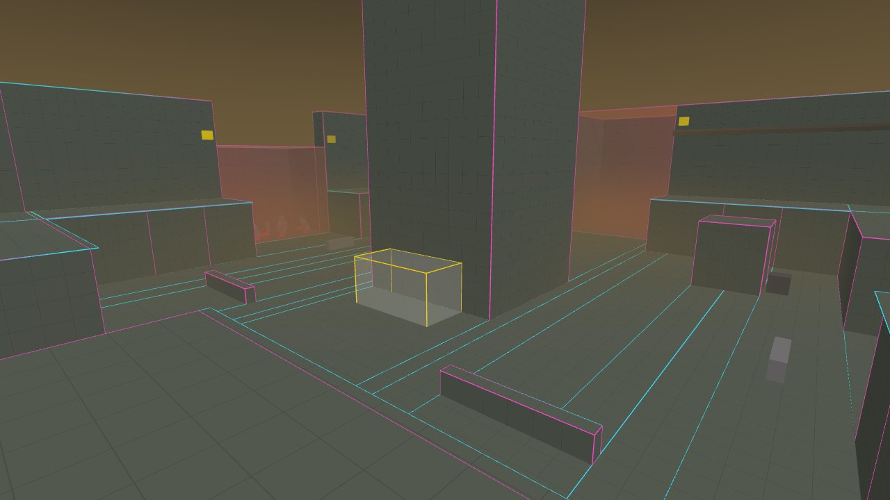
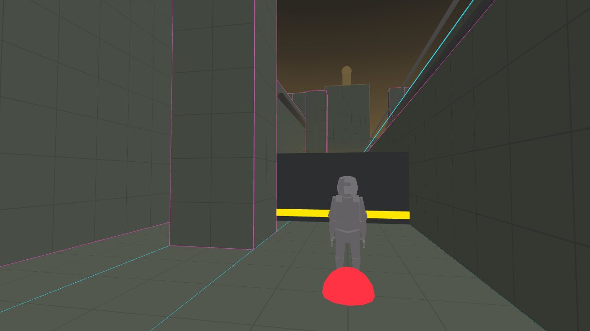

## Dependencies outside the levels lane

1. **#155, tank per level.** Last Colour's 80 ink isn't wired; every level gets 100.
2. **#156, paintable surfaces readable.** The six balcony climbs and three pockets are the level's whole defence, and in the game they look like the steel around them.
3. **#99 Big Arm**: its bay is built, it is not (a cut candidate). **#100 the Siphon** is built (R5).
4. **The laser grid** (#33) is parked; the crusher is built (polish pass 1).

---

## Decisions (Renda, 29 Oct: the recommended default on all five)

1. **Two breaths:** wave 3 waits 8 s after wave 2; Big Arm's gate pulses for 12 s before it drops. This added one rule to the shared level code: `cleared:R3.2+8`, a rule with a delay, latched so leaving the room doesn't cancel it.
2. **The Core stays open behind you.** Retreating means walking back under two turrets.
3. **Wave 3 stands visible behind wave 2.**
4. **Big Arm's bay is built now**; the cut is decided in the campaign pass.
5. **The placeholder win** (reach the intake with the Core clear) stayed until #100. **Superseded 30 Oct:** the Siphon is built and the win is phase three (R5).

## What building it caught

| Found | Fix |
|---|---|
| **Two balcony lips crossed** at the south-west corner: a 0.3 × 0.3 m square with two floors in one plane | The builder now lets the first block keep a corner where two lips at the same height meet (the Ascent's fix only covered a lip running into a neighbour's *box*) |
| A registry test still used `last-colour` as "the stub level" | It uses the Primer now, the only stub left |

And one my own test got wrong: the breath counts from the tick that **sees** wave 2 gone, so my first test stepped 7.5 s, not 8, and correctly saw wave 3 still asleep. The test was fixed, not the level.

**Built, from the corridor:** the Siphon and its beacon close the view, as the massing model said they would.

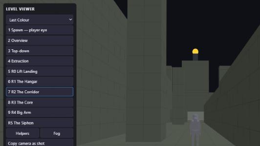

## Deliberately undecided

Turret facing, every combat paint number, Big Arm's combo, and the Siphon's phase timings.
